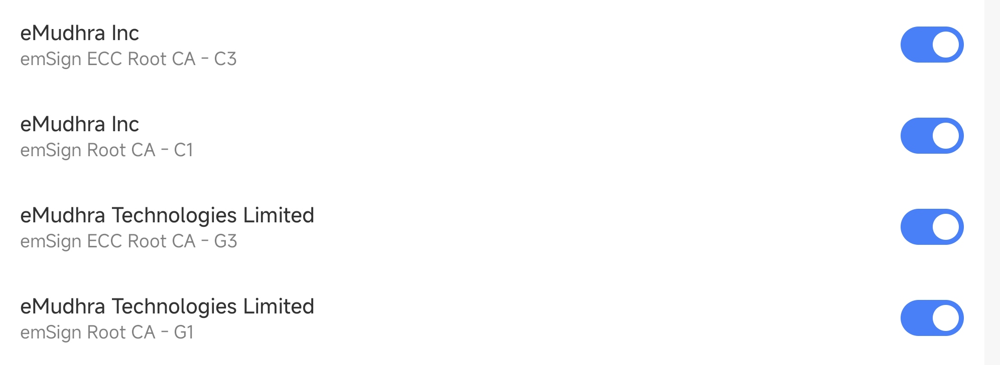
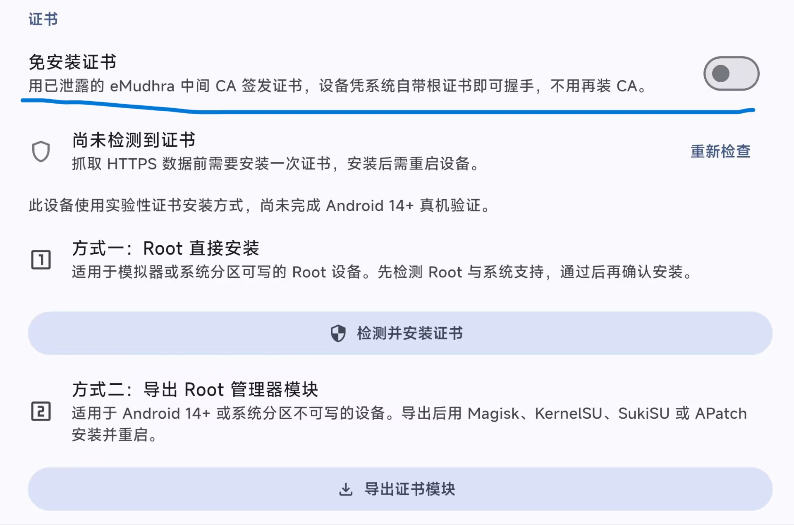
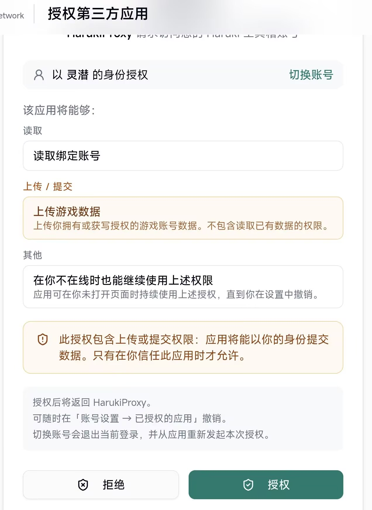
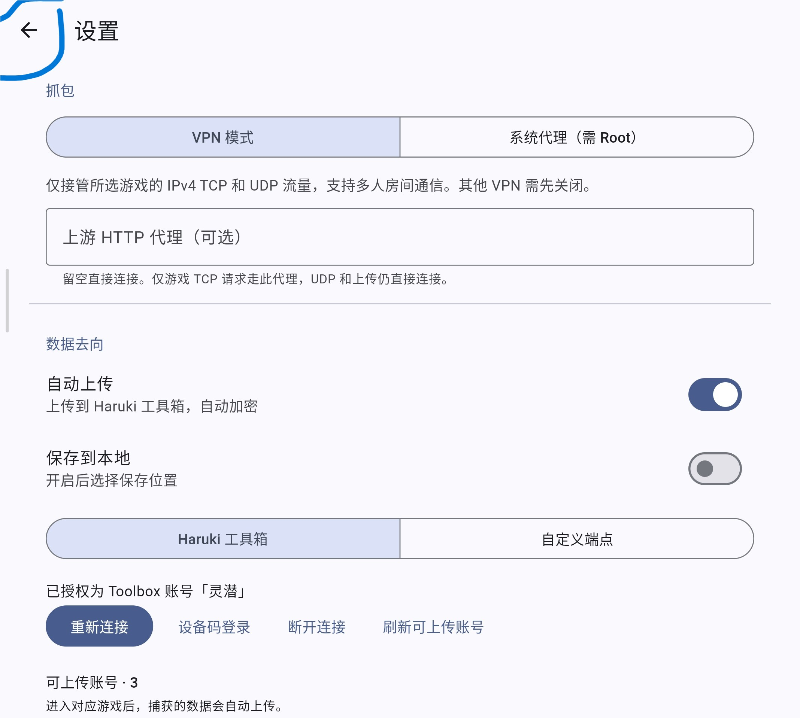
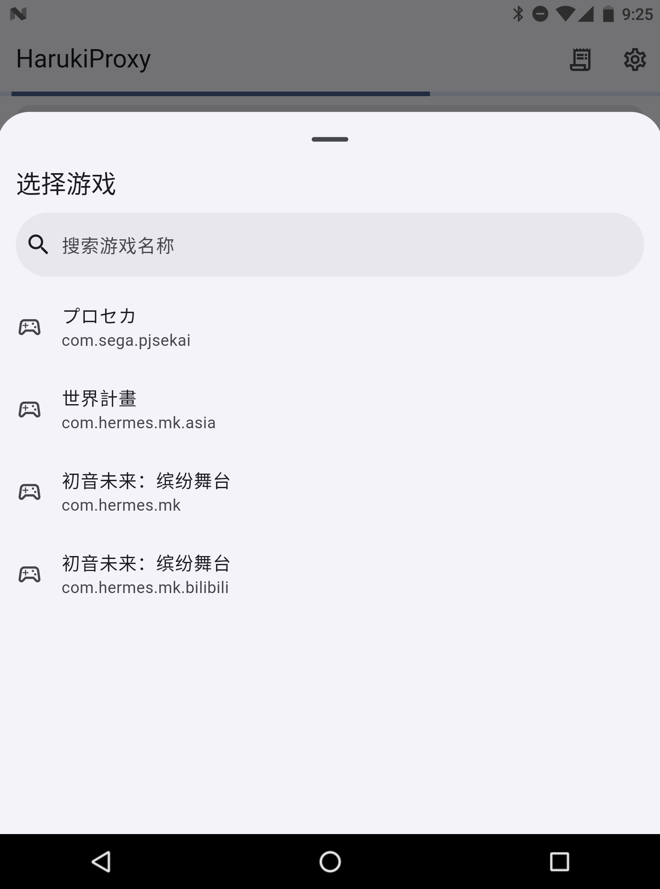
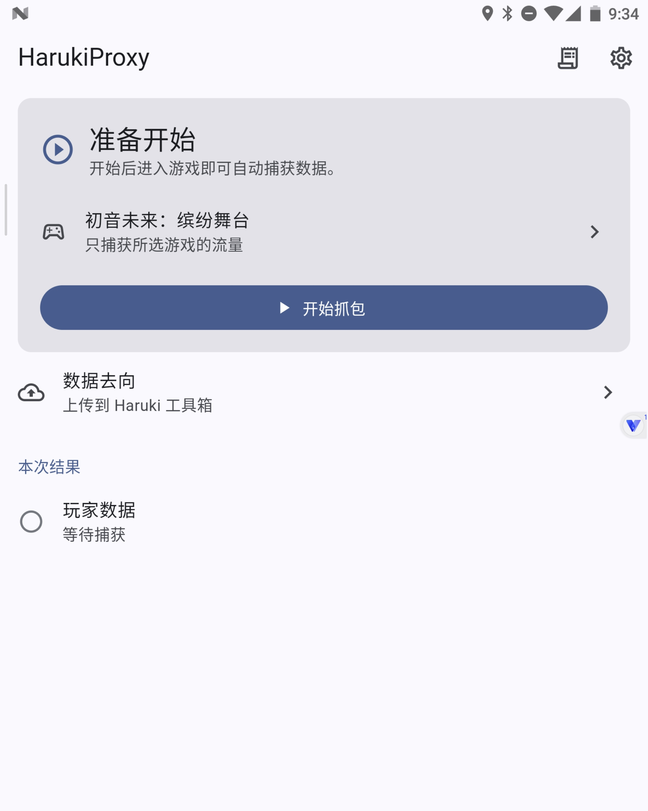
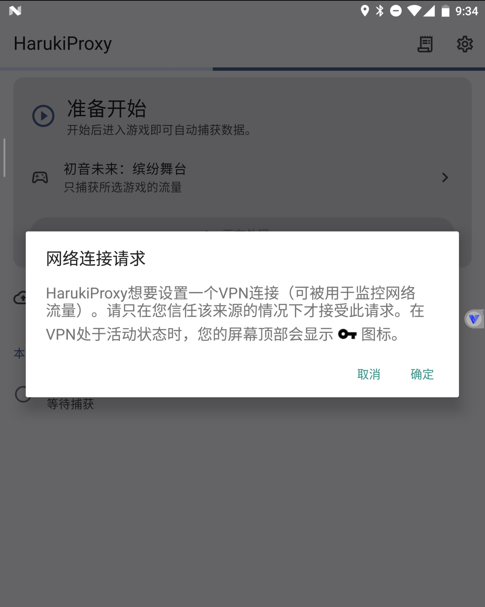
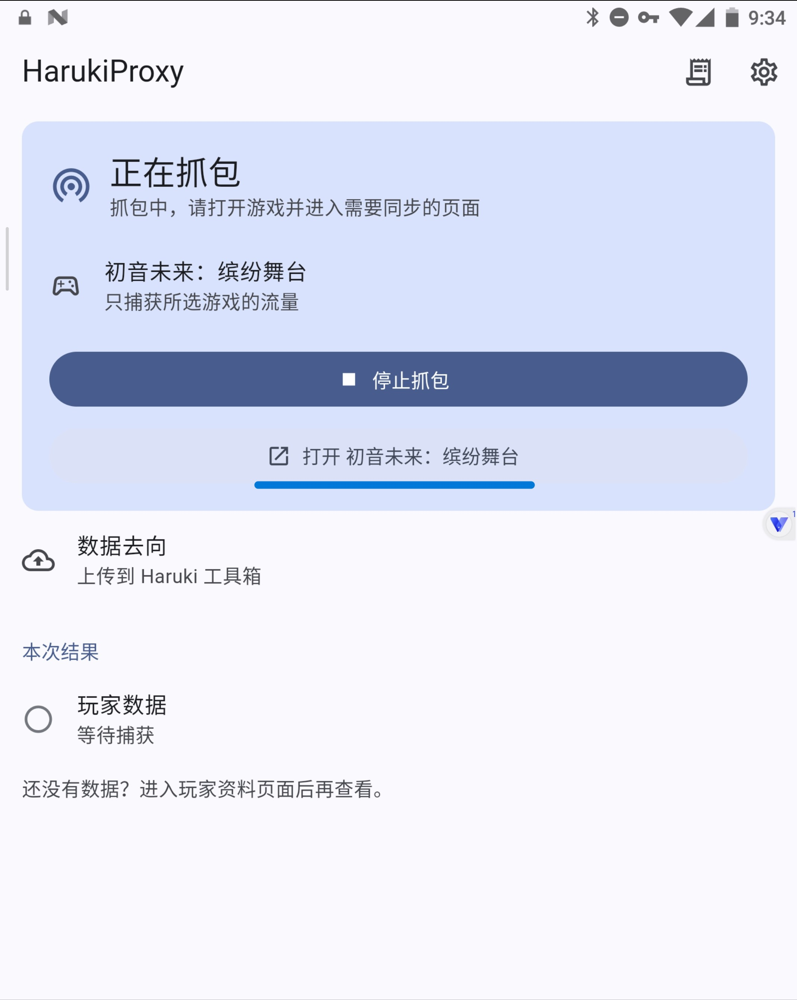
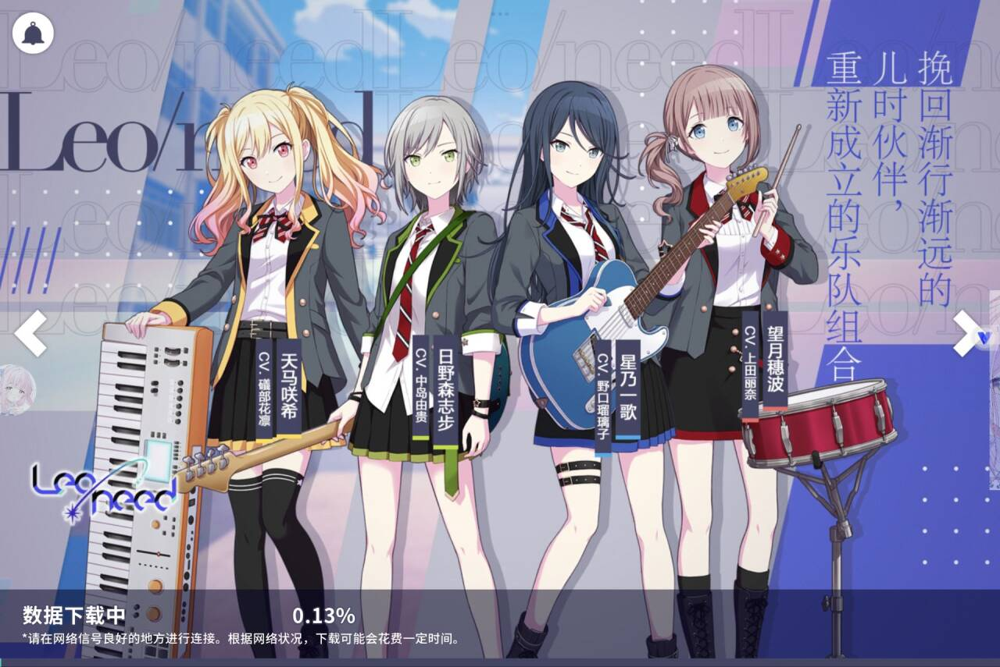
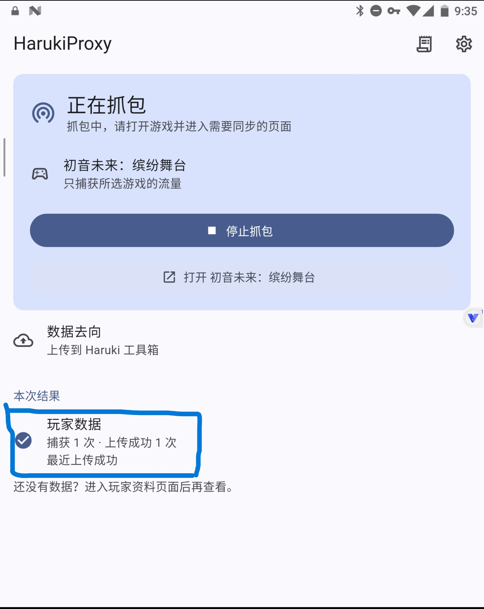

# 无需光速虚拟机的免Root抓包方式

> [!caution] 阅读前警告
>
> 该方法受限于Android系统版本，如果你的Android系统的安全更新在2026年10月21日之后，那么这个方法将会失效。
> 
> 使用该方法请务必确保抓包完毕后自行关闭相关证书信任，以免遭到诈骗。
> 
> 如果你的系统证书已经被更新过，或者你不希望使用被破解的证书，可以尝试[光速虚拟机的方法](./android.md)

## 原理
Android系统信任的根证书中有印度人签发的证书，该根证书的密码过于简单已被破解。HarukiProxy可以直接使用该证书而不需要额外的安装证书。同理其他的应用也有可能利用该证书所以在不使用时请务必关闭相关证书的信任。只要证书中出现了`eMudhra`或者`emSign`相关字样的（如下图），就是被破解的证书。

## HarukiProxy设置

- [HarukiProxyV3-Android安装包](https://haruki-dl-esa-cn.seiunx.com/HarukiProxy/v3.0.0-beta.7/HarukiProxy-v3.0.0-beta.7-android-arm64.apk)

点击上方连接下载HarukiProxy，直接安装到安卓机上。
### 证书安装
首先启动HarukiProxy，打开软件后首先点击右上角的设置按钮，往下翻找到证书设置的位置。

打开`免安装证书`选项即可，不用管兼容旧设备选项。
### 工具箱授权
在设置中找到`连接Haruki工具箱`，点击打开浏览器。登录你的Haruki工具箱账号，进入到授权页面，已登录过会直接打开。

**确定是你自己的号自己的设备码**，然后点击授权，将会回到HarukiProxy，可以看到登陆的工具箱账号和其中绑定的游戏账号。

点击左上角的`←`回到HarukiProxy主页。至此HarukiProxyV3-Android就设置好了。接下来开始抓包了。

## 开始抓包
在HarukiProxy的主页点击选择游戏，需要注意国服的官服和b服的游戏名称相同，带有bilibili的是b服，另一个是官服。选择你要抓包的游戏。

点击“开始抓包”按钮，同意网络连接请求，然后点击“打开 初音未来：缤纷舞台”。正常登录自己的账号，等待到这下图一步就好，不用下载游戏数据。

然后回到HarukiProxy的主页，你就能看到玩家数据捕获与上传的情况。

这样一来抓包就完成了，可以使用bot的需要抓包的功能了。

# 附录

## 关闭被破解的证书信任
不同的手机可能不同，一般在手机设置的 安全 -> 加密与凭据 -> 信任的凭据 -> 系统凭据 。
只要证书中出现了`eMudhra`或者`emSign`相关字样的（如下图），就是被破解的证书，将他们关闭。

