# HarukiProxyV3-PC
> [!caution] 阅读前警告
>
> HarukiProxy V3桌面版目前是测试版，最新版本为`v3.0.0-beta.7`，本文档的介绍以及教程均根据此版本编写
>
> V2已完全废弃，Haruki工具箱也不再接受V2上传的数据。
>
> 如果你不是模拟器用户，而是Android实体设备用户，请转至[HarukiProxy-Android教程](./android.md)

## **初期准备**
> [!caution] 阅读前注意
> ***本程序自动化功能仅针对MuMu模拟器或其他可手动获取root可写系统盘的设备***
> 
> ***Windows的MuMu模拟器版本需要V4.0.0.3179及以上版本才可使用HarukiProxy自动配置MuMu功能。如果你的MuMu版本不符合要求，请先升级***

> [!tip] 提醒
>
> 配置出现问题时请先查找是否为常见问题，再借助搜索引擎和ai尝试解决问题，最后再在群聊里问群友，不会提问的请务必先阅读[提问的智慧](https://github.com/ryanhanwu/How-To-Ask-Questions-The-Smart-Way/blob/main/README-zh_CN.md)

最新版的HarukiProxy链接为：

- [HarukiProxy-Windows-x64](https://haruki-dl-esa-cn.seiunx.com/HarukiProxy/v3.0.0-beta.7/HarukiProxy-v3.0.0-beta.7-windows-x64.zip)
- [adb补丁包](https://haruki-dl-esa-cn.seiunx.com/HarukiProxy/v3.0.0-beta.7/HarukiProxy-v3.0.0-beta.7-windows-x64-adb.zip)：`v3.0.0-beta.7`的安装包漏打包了adb，请一并下载

下载完成后，将压缩包放至自己喜欢的目录，然后进行解压，再把adb补丁包解压到`HarukiProxy.exe`所在的目录

> [!caution] 注意
>
> ***请不要使用系统自带的解压方式！！！由于会产生很多不必要的问题，这里极度建议下载一个解压软件对压缩包进行解压***
>
> ***本文推荐使用7-zip 官网地址：https://www.7-zip.org/***

## **设置HarukiProxy**

正常情况下，压缩包解压后的目录中会有如下内容

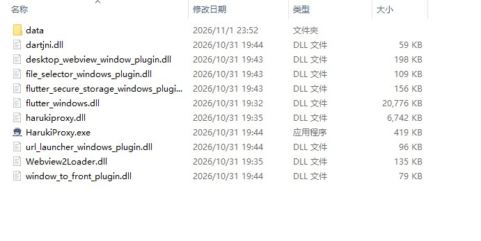

解压adb补丁包后，这个目录里还会多出`adb.exe`、`AdbWinApi.dll`、`AdbWinUsbApi.dll`三个文件

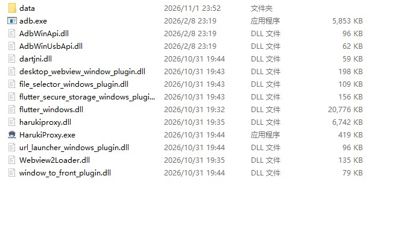

双击并运行HarukiProxy.exe进入图形化界面

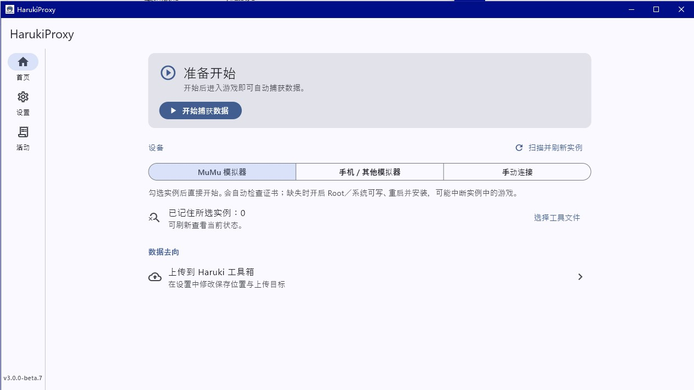

### MuMu与设备维护

点击图形化界面左侧的***设置***，然后点击***选择文件***，选择你的MuMu模拟器下的MuMuManager.exe

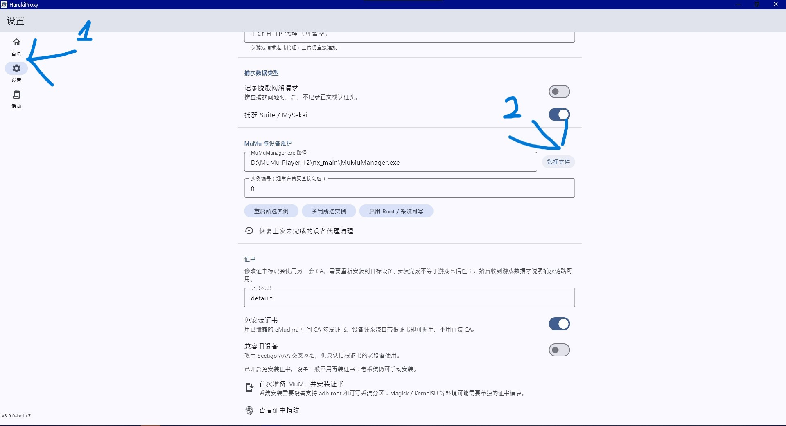

MuMuManager.exe一般位于

```
C:\Program Files\Netease\MuMuPlayer-12.0\nx_main\MuMuManager.exe
```

如果你并不知道自己的程序所在位置，请执行以下流程

1. 按理来说，在安装时MuMu模拟器会自动在你的桌面创建一个快捷方式
   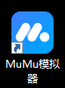

2. 接下来，右键这个快捷方式，并在接下来弹出的菜单中选择“打开文件所在的位置”
   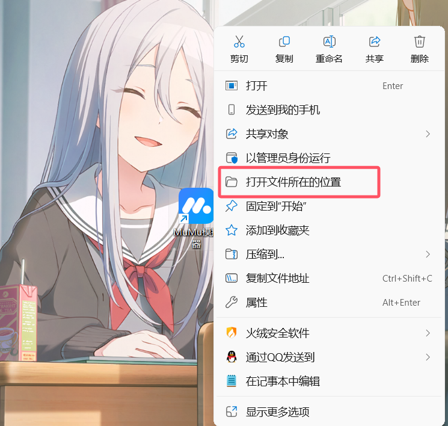
   接下来你就会跳转到MuMu模拟器安装的目录，系统会用蓝色标识出快捷方式连接到的“MuMuNxMain.exe”
   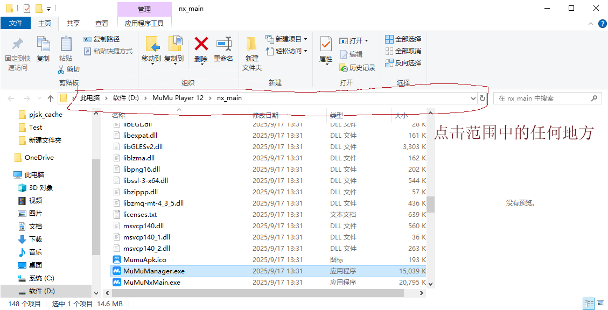

   我们的目标是在它上面的`MuMuManager.exe`。复制文件管理器地址栏里的路径，在结尾加上`\MuMuManager.exe`，形成`复制的路径\MuMuManager.exe`的格式

   然后回到之前点击***选择文件***弹出的窗口，把这个路径粘贴到***文件名***一栏，点击***打开***确认
   
   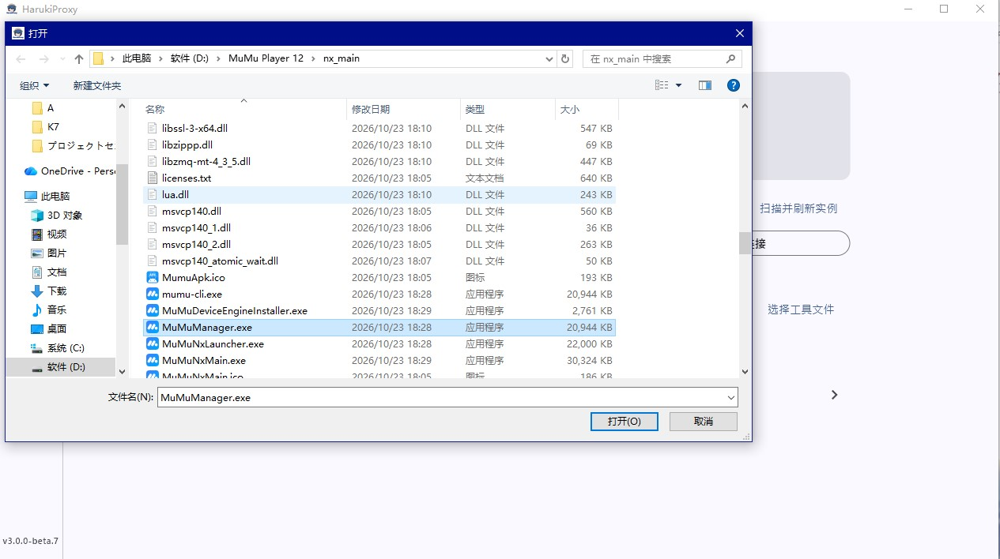

设置完这些后，请确认设备的实例编号是否正确，它要和MuMu模拟器中你要使用的设备左上角的`#`编号一样

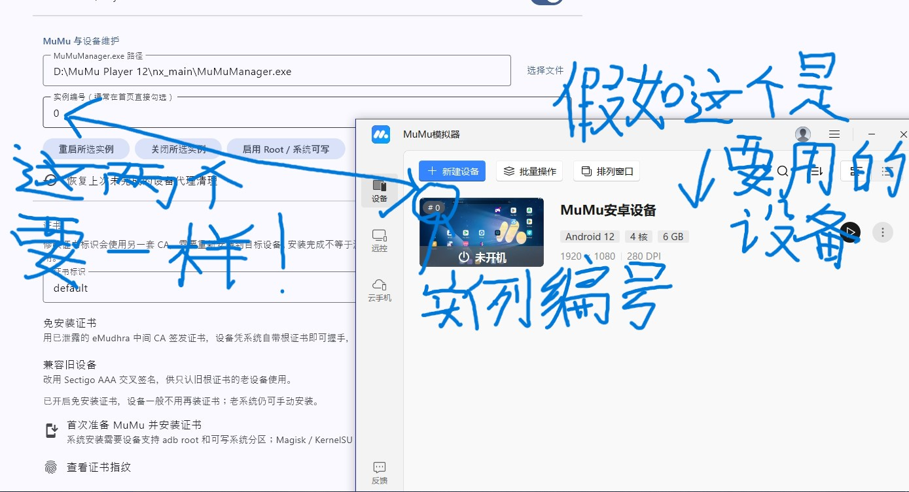

然后，点击***启用 Root / 系统可写***（如果你明确这台设备已经启用了root，可以跳过）。如果实例正在运行，再点击***重启所选实例***让设置生效

### 上传设置

依旧在***设置***界面，上滑来到***数据去向***

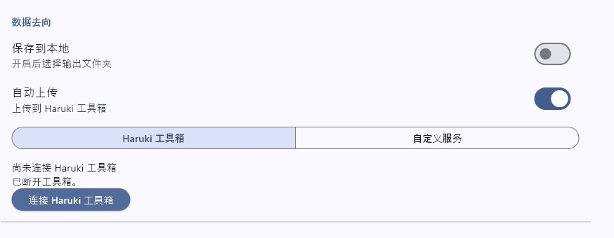

假如想要自动上传到Haruki工具箱，首先开启***自动上传***选项，然后点击***连接Haruki工具箱***，完成认证并确认你需要抓取数据的账户出现在列表中。只有列表中的账户才会上传，登录其他账户时数据不会上传

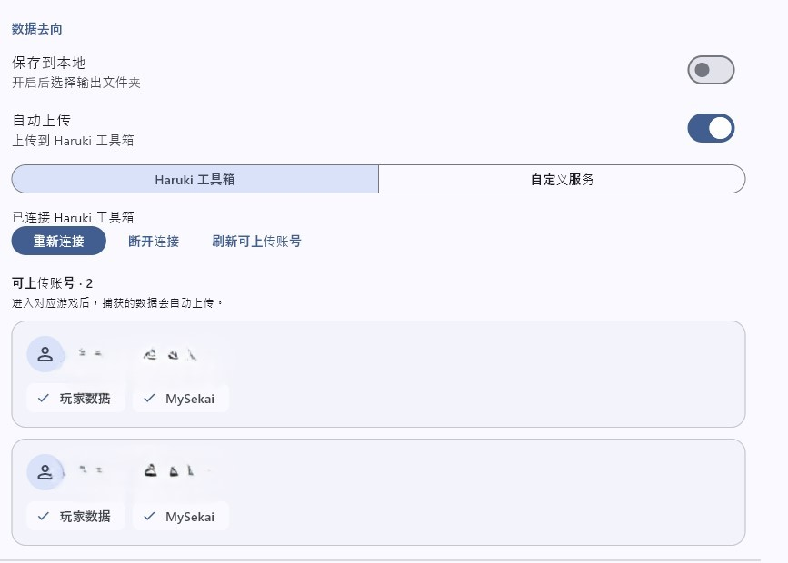

如果想要将抓取到的Suite或MySekai数据保存在本地，开启***保存到本地***选项并指定保存位置，数据会保存在所选文件夹的`harukiproxy-data`子目录

接着，确认下方的***捕获 Suite / MySekai***选项处于开启状态，上方的***自动配置设备网络***如果不知道是什么意思请保持开启，***上游 HTTP 代理***保持留空

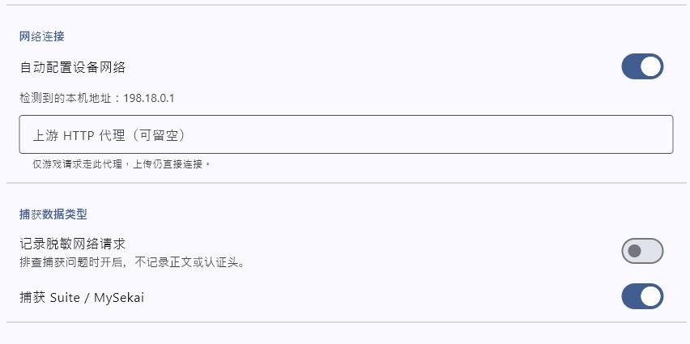

### 证书

最后一步是进行证书准备

这一部分提供了两种设置方式

1. 使用已泄露的中间CA证书进行无需额外安装证书的抓取

使用须知：Android系统自带并信任印度CA eMudhra的根证书，而它的一张中间证书私钥已经泄露。HarukiProxy可以用这张中间证书签发抓包证书，系统直接信任，不需要额外安装证书。同理其他应用也可能利用它，所以不用时请务必关闭相关证书的信任。在设备设置中搜索受信任的凭据进入，只要证书中出现了`eMudhra`或者`emSign`相关字样（如下图），就是相关的证书。
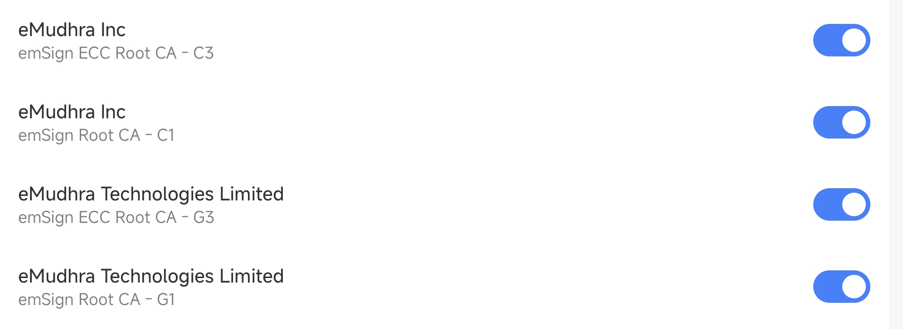

使用这种设置方式，开启***设置***界面中的***免安装证书***选项

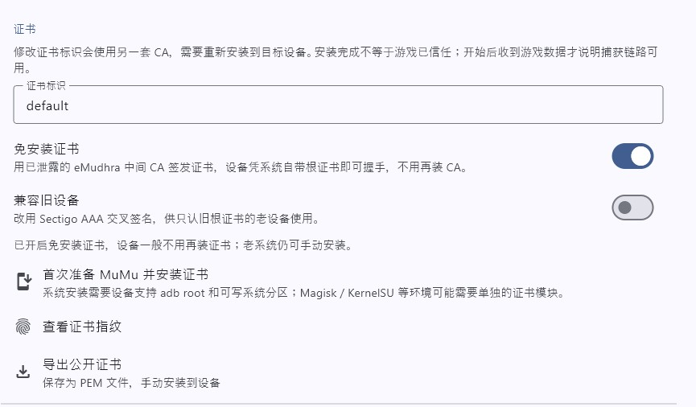

（如果你抓取使用的设备运行的是Android10以前的系统，请打开下方的***兼容旧设备***选项）

2. 使用HarukiProxy的证书

关闭***免安装证书***选项，点击***首次准备 MuMu 并安装证书***，根据流程进行准备

> [!caution] 注意
>
> 如果界面提示有未保存的设置，请点击***立即保存***。保存后的设置在下次捕获时生效

## 使用HarukiProxy

回到***首页***，点击***开始捕获数据***，会自动启动MuMu模拟器实例，首页出现***运行中 · 等待游戏数据***后进入游戏即可进行抓取。抓取完成后，点击***停止并恢复设备***

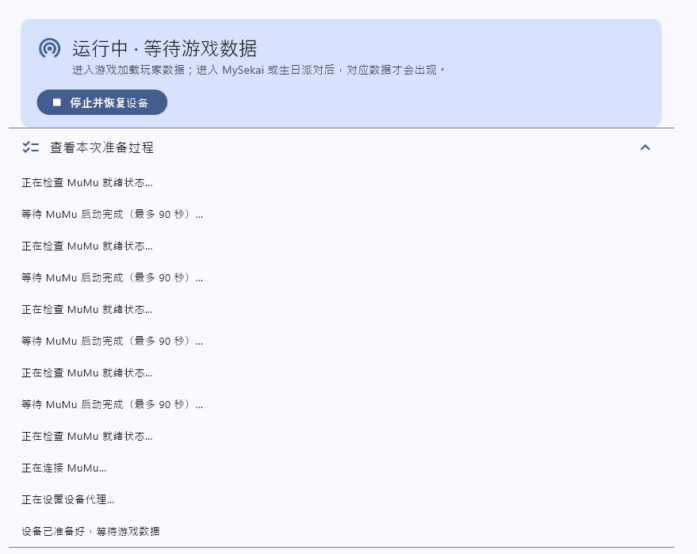
> [!caution]
>
>请一定要先在Proxy中 ***停止并恢复设备*** 再退出模拟器，否则会出现网络异常的情况!!!
## 常见问题

### 提示“无法启动 ADB，请安装 platform-tools 并加入 PATH”

请确认adb补丁包已经解压到`HarukiProxy.exe`所在的目录，`adb.exe`和`HarukiProxy.exe`要在同一层，然后重试

### HarukiProxy异常退出后，模拟器里的游戏连不上网

模拟器里可能还留着代理设置。重新打开HarukiProxy，在***设置***界面点击***恢复上次未完成的设备代理清理***