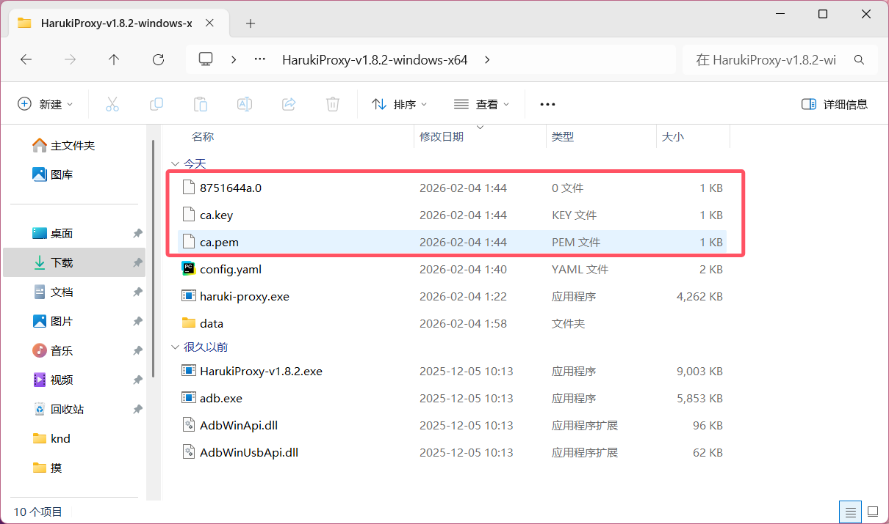
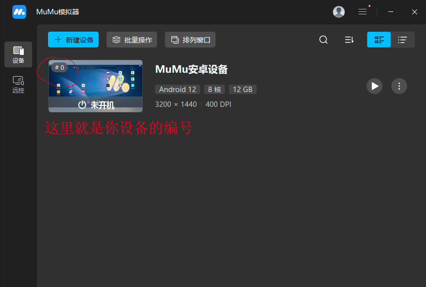

# HarukiProxy 介绍与教程
> [!caution] 阅读前警告
>
> 当前HarukiProxy的发布版本为`v2.1.0`，本文档的介绍以及教程均根据`v2.0.0`以上版本编写  
> 
> 如果你目前使用的版本低于v2.0.0，并且希望使用v2.0.0以后续版本，则更新到v2.0.0以上版本时，需要先删除先前版本的证书文件
> 
> 
> 如果你是不是模拟器用户，而是Android实体设备用户，请转至[HarukiProxy-Android教程](./android.md)

## **初期准备**
> [!caution] 阅读前注意
> ***本程序自动化功能仅针对MuMu模拟器或其他可手动获取root可写系统盘的设备***
> 
> ***Windows的MuMu模拟器版本需要V4.0.0.3179及以上版本才可使用HarukiProxy自动配置MuMu功能。如果你的MuMu版本不符合要求，请先升级***
>
> [!tip] 提醒
>
> 配置出现问题时请先查找是否为常见问题，再借助搜素引擎和ai尝试解决问题，最后再在群聊里问群友，不会提问的请务必先阅读[提问的智慧](https://github.com/ryanhanwu/How-To-Ask-Questions-The-Smart-Way/blob/main/README-zh_CN.md)

最新版的HarukiProxy链接为：

- [HarukiProxy-Windows-x64](https://haruki-dl-esa-cn.seiunx.com/HarukiProxy/v3.0.0-beta.7/HarukiProxy-v3.0.0-beta.7-windows-x64.zip)
  
下载完成后，将压缩包放至自己喜欢的目录，然后进行解压

> [!caution] 注意
>
> ***请不要使用系统自带的解压方式！！！由于会产生很多不必要的问题，这里极度建议下载一个解压软件对压缩包进行解压***
>
> ***本文推荐使用7-zip 官网地址：https://www.7-zip.org/***

解压后请运行Haruki proxy.exe 其他文件在正常使用中不会用到

## **设置Haruki proxy**

这里会介绍所有设置项，如果你不会使用Haruki proxy，请跟着介绍进行配置

### 数据去向

保存到本地：将抓取的数据保存到指定目录，不影响上传，可以根据需要自行选择开关

选择输出文件夹：指定文件保存的位置

自动上传：将抓取的数据自动上传至Haruki工具箱，推荐打开

连接Haruki工具箱：在这个选项绑定你的Haruki工具箱账号，点击连接会自动跳转工具箱授权页面，授权后会列出绑定的账号。请注意只能上传已绑定账号的数据，如登录其他账号数据不会上传

### 网络连接

自动配置设备网络：推荐打开

上游HTTP代理：如果连接不到游戏服务器可以填写，需要自行准备其他工具，这里不做介绍

### 捕获数据类型

记录脱敏网络请求：如果需要在反馈报错中附上日志，请打开这个选项

抓取Suite/Mysekai：打开 （不开你用什么proxy

### MuMu与设备维护

MuMuManager.exe路径：选择你的MuMu模拟器下的MuMuManager.exe，一般位于

```
mumu_manager_path: "C:\\Program Files\\Netease\\MuMuPlayer-12.0\\nx_main\\MuMuManager.exe"
```

如果你并不知道自己的程序所在位置，请执行以下流程

1. 按理来说，在安装时mumu模拟器会自动在你的桌面创建一个快捷方式,如果你删除了这个快捷方式，那么请查看结尾的处理方式
   

2. 接下来，右键这个快捷方式，并在接下来弹出的菜单中选择“打开文件所在的位置”
   
   接下来你就会跳转到mumu模拟器安装的目录,系统会用蓝色标识出快捷方式连接到的“MuMuNxMain.exe”
   

   我们的目标是在它上面的`MuMuManager.exe`

实例编号：需要抓取的实例编号，可以在主页勾选，一般为0

打开你的MuMu模拟器，在你的虚拟机左上角，应该会有一个#x的编号
   

设置完这些后，请点击`启用ROOT/系统可写`并`重启所选实例`

### 证书

证书部分提供了两种设置方式，1比较简单，2比较安全，请根据你的需要自行选择

1. 打开免安装证书和兼容旧设备，可以直接完成这一步的设置，但是请阅读下面须知

使用须知：Android系统自带并信任印度CA eMudhra的根证书，而它的一张中间证书私钥已经泄露。HarukiProxy可以用这张中间证书签发抓包证书，系统直接信任，不需要额外安装证书。同理其他应用也可能利用它，所以不用时请务必关闭相关证书的信任。只要证书中出现了`eMudhra`或者`emSign`相关字样（如下图），就是相关的证书。


2. 首次准备MuMu并安装证书：打开模拟器对应实例后点击这个选项会自动安装证书。

> [!caution] 注意
>
> 记得保存你所更改后的设置

## 使用Haruki proxy

点击主页的`开始捕获数据`后，打开实例里你想要抓包的游戏客户端并登录你的账号，就会自动抓取数据了。